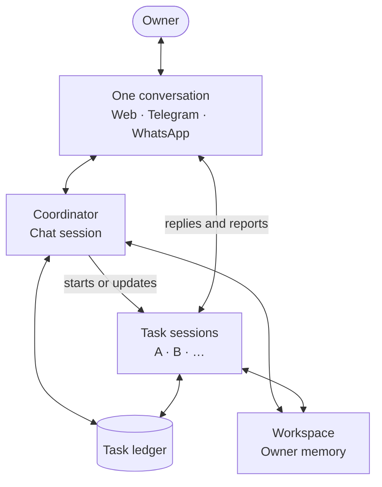

Nod has one conversation per owner. The main chat session coordinates work. Each independent task gets a saved session in the same conversation. On web and desktop it answers in its own [named chat](#named-chats); in a chat app it answers in that chat app's conversation.

Quick answers, simple lookups, status questions and short work in your connected apps, such as reading, drafting, sending, forwarding or deleting a few emails, stay in chat. Other substantial work, including multi-step work that can finish in one sitting, an outside wait, or your explicit request to track work starts a saved task, and Nod chooses that itself without asking you for an execution mode. A new independent request while other work runs starts its own task; corrections and related updates go to the existing task. The chat itself has no browser, sign-in, payment or computer tools, so work that needs the browser, a login, a payment or a desktop app always runs in a task with its own context, browser and questions; web lookups stay in chat. A new message in a chat or task closes that session's older open questions; other tasks keep theirs.

## The architecture



The conversation is the owner's view of the work. The coordinator assigns work and routes ordinary follow-ups. A task session does the work, asks its own questions and delivers its own results. The coordinator does not rewrite each result through another model call.

Explicit replies go to the selected task before the coordinator runs. The task's message identifies which work the owner is answering.

## Three separate concepts

| Concept | Purpose                                                   | Lifetime                                                |
| ------- | --------------------------------------------------------- | ------------------------------------------------------- |
| Task    | The goal, completion condition, progress and result.      | Until completed or stopped; its record stays available. |
| Session | The saved Pi history and execution context for that work. | Across turns, questions and owner updates.              |
| Turn    | One execution started by a message, dispatch or resume.   | Until it succeeds, waits, fails or is cancelled.        |

A task can need several turns in the same session. A successful turn does not mean the task is complete. The task calls `finish` after it checks its completion condition. A turn that ends with its final answer, as final text or with `send_message` intent `final`, also closes the task as done when nothing else is planned: no wait, later check or queued owner update. The result is that answer.

Each session runs one turn at a time. Different sessions run in parallel. There is no task limit of three. Browser capacity is a separate resource limit; a task that does not browse does not open a browser.

## One task ledger

The `tasks` table is the source of truth for task state. Task messages, web cards and Telegram status replies show that state; they are not separate task records. The model writes every task message from that state, in the conversation language described in [Agent runtime](/how-it-works/agent-runtime/), even when the task was requested in another language.

| Record        | Owns                                                                                                                              |
| ------------- | --------------------------------------------------------------------------------------------------------------------------------- |
| `tasks`       | Goal, completion condition, brief, source owner message, session and message links, steps, progress, update revisions and result. |
| `turns`       | Execution state, session, task, reply channel and resume links.                                                                   |
| `messages`    | Owner input, questions, replies and delivered file links.                                                                         |
| `turn_events` | Tool and helper activity for the task's activity view.                                                                            |
| `model_usage` | Model requests and their cost.                                                                                                    |

Each turn sees up to 100 tasks of the active conversation, open ones first, then finished ones with their results, newest first. After a conversation reset in a development build, tasks from the archived conversation stay saved and on the Tasks page, which lists up to 100, open ones first, but leave the turn context.

A model-written task list in the workspace does not replace the ledger. The existing turn queue runs the sessions. The task system does not add another scheduler or cost ledger.

## Start, reply and finish

1. The owner gives the coordinator an independent goal. The coordinator uses `task start` with a title, completion condition, brief and planned steps.
2. One transaction saves the task, posts its first message and queues its first turn. A task started from chat uses its task ID as the session ID. The original owner message stays linked to the task.
3. The worker opens that saved session. The task updates its steps as it works. Text the model writes between tool calls becomes the task's live status: its card shows it, with the website while it browses. It isn't posted, because the task's first message already says what it is doing. Its questions, files, deliberate `send_message` updates and final reply reach the conversation; if it ends without a final reply, its last such text is posted instead. A reply from the owner while the task works gets its answer as a message. Event and schedule runs stay quiet.
4. If the task needs the owner, it asks a question and waits. Other sessions continue.
5. A reply to the task's first message, question, file or result continues that task, even if it finished or stopped. An ordinary message goes to the coordinator, which can forward the exact owner message to selected open tasks. If the latest message is a finished task's result, an explicit retry can reopen that task with its original request, provided the owner started it. Web and desktop match the shared conversation. Chat apps match their own chat. If the target is unclear, Nod asks. In web and desktop, a task working on a message routed this way shows its working dot, title and live status under that message. It takes the place of the chat's own activity line until the task posts a message, finishes or needs the owner. Selecting it opens the task.
6. The task checks its completion condition, shares any result files and calls `task finish`. Its final reply goes directly to the owner: into its [named chat](#named-chats) on web and desktop, with its short result under the request in the main chat, or into the chat app's conversation. Its status stays working until that reply is posted.

Each owner update has a revision. The server records delivery at a model boundary. A task cannot finish while an owner update remains queued. A correction closes the old waiting turn, so an old pending approval cannot execute after that correction. Saved setting changes bind that owner-input revision as well as the setting's version. Chat and task work use the same owner-evidence record, so a chat-started task keeps up to five owner chat messages from the 24 hours before it started. These messages only supply context. Later chat adds no permission. A schedule created or changed by that task retains the exact checked owner inputs and any proposal they answer. Later unrelated chat cannot add permission.

The background observer starts a separate task for an outside action, question, or approval. A stable key for the source record and change returns the existing task. The task keeps event authority and the normal Trust check. Its wait leaves the observer free. A task started during quiet hours begins when they end; its first turn stays queued until then.

A schedule or other event session can also create a task record for its work. It keeps its existing session.

## Shared information, separate histories

All sessions use the same workspace for the owner's conversation:

```text
/workspace/<thread ID>/
├── shared/
└── tasks/
    ├── <task A>/
    │   ├── drafts/
    │   └── outputs/
    └── <task B>/
        ├── drafts/
        └── outputs/
```

Task folders organize working files. They are not security boundaries. A task can read another task's output by its path. It must not overwrite another task's working files.

Each session has its own saved Pi transcript. Owner memory is shared and stays outside the sandbox. Sessions load current memory and task state when they start or continue. The main chat sees the other sessions through its task ledger, which holds each one's state and result, and reads a chat's messages with `task read`.

Shared storage does not put every change into every active model context. The server delivers addressed owner updates. Tasks read current ledger state and shared files when they need them. Use saved reports and file paths to pass results between tasks; do not depend on another session's private history.

Coordination goes through the main session and ledger. Task sessions cannot forward owner updates to other tasks. They can read shared outputs. `delegate` is different: it runs temporary helpers inside a turn, returns their results to the parent and does not create saved task records.

Shared information does not grant permission. For a task started from chat, the trust check uses the conversation that led to the task, including the original request, and the messages sent to that task. Other task reports, files, briefs and memory cannot authorize an outside action. See [Approvals](/trust/approvals/).

## Named chats

A named chat, a side chat in the app, is a task that has a `name`. Its ID is its session ID, as for every task started from the main chat. The same task row serves each request the chat handles, so the ledger has one entry per chat.

| Rule          | What the server does                                                                                                                                                                                                                                                                                                                                                                                                                                                                                                                                                                                                                                                                                                                                                                                                                                |
| ------------- | --------------------------------------------------------------------------------------------------------------------------------------------------------------------------------------------------------------------------------------------------------------------------------------------------------------------------------------------------------------------------------------------------------------------------------------------------------------------------------------------------------------------------------------------------------------------------------------------------------------------------------------------------------------------------------------------------------------------------------------------------------------------------------------------------------------------------------------------------- |
| Target        | A message sent from a chat's view carries that chat's ID and goes to it. No model chooses the target. A reply target from another chat is refused.                                                                                                                                                                                                                                                                                                                                                                                                                                                                                                                                                                                                                                                                                                  |
| Fresh request | A message to a chat whose request is closed starts a new request: its turn has no parent, it becomes the task's source request, and owner messages from earlier requests become background that cannot authorize an action. One function restarts a chat for both the owner and the coordinator: it replaces the goal and brief and clears the steps, waits, planned check and result. A request the owner types takes its goal from the message; if that request is withdrawn, the chat's name stands in for it. A message to an open request, or to a chat whose last turn is still running, continues it. An emoji reaction never starts a request: its turn joins the chat and leaves the request as it is.                                                                                                                                     |
| Reuse         | The coordinator gives a closed chat its next request with `task start` and the chat's ID. Names are unique among the conversation's chats that are not archived. While other chats exist, the server refuses a new named chat that gives no reason why none of them fits, and lists them in the refusal.                                                                                                                                                                                                                                                                                                                                                                                                                                                                                                                                            |
| Placement     | On web, every message of a chat's turn is saved as chat-only, including its questions, approvals and failure notices: they show in the chat, and the main chat shows the coordinator's start message with a link to the chat, and one report per turn that closes a request asked in the main chat. `task finish` limits a chat's result to 300 characters. A chat whose turn ends without `task finish` saves its whole reply as the result, as every task does; the web app, the ledger and `task read` leave out a chat's result over that limit. Chat apps show a task's result as before, and a message for a chat-app turn is never chat-only. An owner message typed in a chat stays in that chat, including one that Stop caught on arrival. When the coordinator gives a chat a new request, the start line of the previous one is hidden. |
| Report        | When a web turn of a chat closes a request whose owner message is in the main chat, the server posts one report in the main chat as a reply to that message (`messages.chat_report`): the `task finish` result, or the first paragraph of the turn's last reply cut to 300 characters when no short result exists. A turn that fails posts its failure notice there the same way. A report belongs to the chat's turn, so a reply to it goes to that chat, and it never appears in the chat's own view, `task read`, chat search or the chat's own context. A request typed inside the chat reports nothing. Notifications skip a report, because the chat's own reply already notifies.                                                                                                                                                            |
| Names         | A task the owner starts always has a name. When neither the owner nor the coordinator gives one, the server takes the first two words of the task's title, **New chat** for a chat the owner creates, or **Side chat** for one continued from the main chat, and marks the name as automatic (`tasks.name_auto`). The chat's own session is asked on every turn to replace an automatic name with `task name`, which works once; after that, and for every name the owner or coordinator chose, only the owner renames it.                                                                                                                                                                                                                                                                                                                          |
| Continue      | `POST /api/chats` with `from` creates a kept chat from one main-chat answer of the main session that is not withdrawn. The chat stores that answer (`tasks.continued_from`), takes the request it answered as its title and brief, and runs no turn until the owner writes in it. Its session already imports the main-chat messages from before it was created, so it starts with the request and the answer. Continuing the same answer again opens the same chat.                                                                                                                                                                                                                                                                                                                                                                                |
| Archive       | A chat with an open request or an active turn cannot be archived. Any new input restores an archived chat; if another chat took its name meanwhile, the restored one gets a number after its name.                                                                                                                                                                                                                                                                                                                                                                                                                                                                                                                                                                                                                                                  |
| Chat apps     | Telegram and WhatsApp keep one conversation. The server puts the chat's name in front of a start line that does not contain it, and a chat's questions and results reply to that line. A reply to any message of a chat goes to that chat; a closed chat starts a fresh request, answered in the chat app. `/tasks` lists open tasks, kept chats and chats closed in the last day. A message typed in a chat's web view is answered on web only.                                                                                                                                                                                                                                                                                                                                                                                                    |
| Replies       | A text reply can answer only a confirmation shown in the view where it was typed.                                                                                                                                                                                                                                                                                                                                                                                                                                                                                                                                                                                                                                                                                                                                                                   |
| Context       | The coordinator imports only messages the main chat shows. Its ledger entry for a chat holds the chat's result and the first paragraph of its latest reply, and counts its chat-only replies. A chat imports its own messages and main-chat messages from before it was created. Every session gets the ledger of the other chats. `task read` with a chat's ID or name returns its goal, state, result, open question and 12 latest messages inside one untrusted block, without withdrawn owner messages; `history_search` accepts a chat ID for older ones. A message belongs to a chat through the turns of that chat, so the list never changes when the chat takes a new request. The trust check sees no tool results, so nothing read from another chat grants an action.                                                                   |

Tasks without a name, which include every task a schedule or the background observer creates, keep the behaviour described above.

## One task across web and chat apps

In web chat, the tasks line counts each open task that has a first message in the main chat. Selecting a named chat opens it. A task without a name has a chip under its first message and a card that opens from the tasks line, with its current work, steps, completion condition, **Reply** and **Stop**. **Scheduled** shows a compact preview for each open and finished task. Expand it for steps, activity, the completion condition and task controls. Activity shows tool and helper events, not private model reasoning. In web and desktop chat, each message the task posts quotes the owner message it belongs to: the latest owner message the task had taken in when it posted, or else the one that started it. Selecting the quote jumps to that message.

Telegram shows the task as messages Nod writes. If its first message arrives as one short text message, a quoted progress section in your language updates there without another notification, then is removed when work stops. Other message types keep typing status only; see [While Nod works](/use/channels/#while-nod-works). Each task keeps its own message and reply target. Its questions and result reply to that first message. `/tasks` sends a replyable status message for each open task. Reply with `/status` to inspect it or `/stop` to stop it. Native reply links for text parts and files select the same saved task in Telegram and WhatsApp.

These are views of one task record and session. A pending approval remains bound to its exact question and action. An old status message cannot approve a later action. Private sign-in and payment steps remain in Nod's private forms.

See [Track tasks](/use/tasks/) for controls and screenshots.

## Stop, restart and reset

- **Stop one task** cancels that session's running, queued and waiting turns and its helpers. Other tasks continue. Only the owner or the main chat acting on an owner message can stop a task; scheduled and background runs can't. An outside action that already started can still finish.
- **Main Stop** stops active work and closes all open tasks. Schedules stay configured.
- **Stop everything from chat** (`task stop` without an ID) cancels the running, queued and waiting turns of every session except the main chat, which includes tasks, scheduled runs and app checks, and closes all open tasks. The chat turn that asked keeps running to report, and later chat messages stay queued. Schedules stay configured.
- **Restart** keeps task records, saved transcripts and waiting questions. A run interrupted during execution fails and is not retried. Its task can continue from a new owner message. The task's interruption notice names the task and replies to its own message when the model can prepare it, so you can tell it apart from a chat request that was interrupted at the same time. If the chat had already handed every request to a task that is still open, only the task sends a notice. It says nothing was sent, submitted or deleted since your last message only when the trust check let no outside action run and no confirmed action ran in that work.
- **Reset** archives the conversation, closes its open tasks and gives the next conversation a new workspace and chat session. Earlier records remain stored.

## Code and related guides

- [`src/server/tasks.ts`](https://github.com/n8n-io/nod/blob/main/src/server/tasks.ts): task ledger, dispatch, updates, reply targets and controls.
- [`src/server/thread.ts`](https://github.com/n8n-io/nod/blob/main/src/server/thread.ts): turn queue, session routing, input delivery and interruption handling.
- [Threads and turns](/how-it-works/threads-and-turns/): execution and session lifecycle.
- [Workspace and files](/use/workspace/): file access and delivery.
- [Memory](/how-it-works/memory/): shared owner context.
